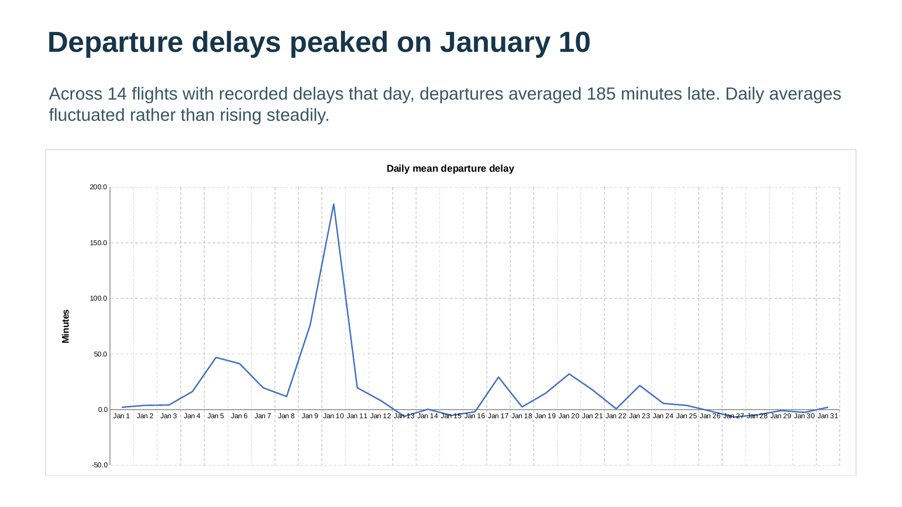
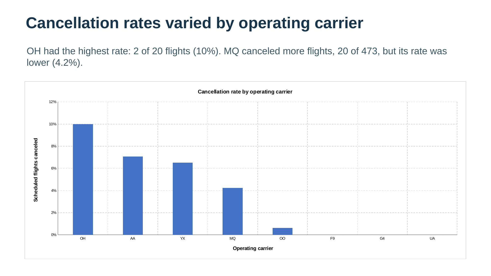
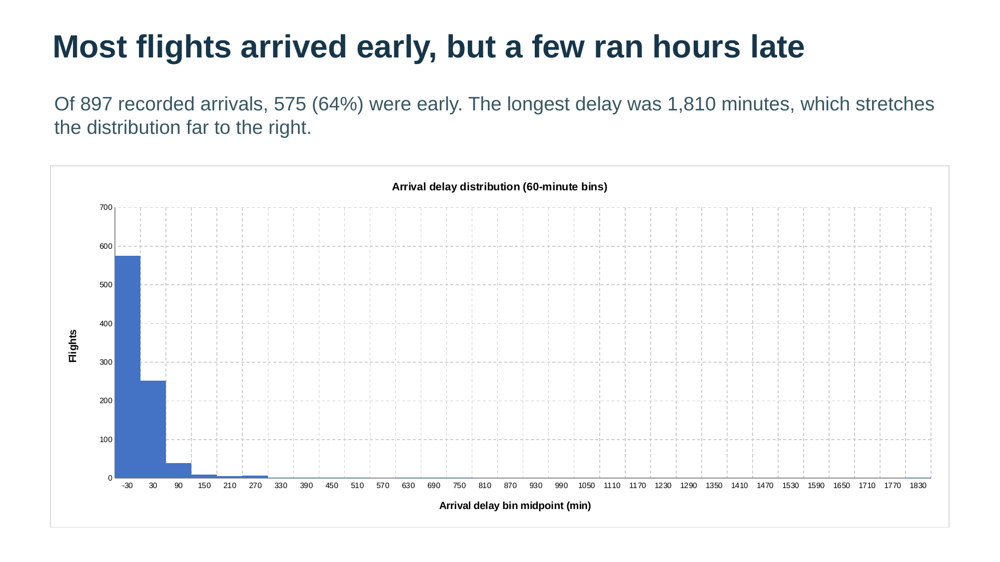
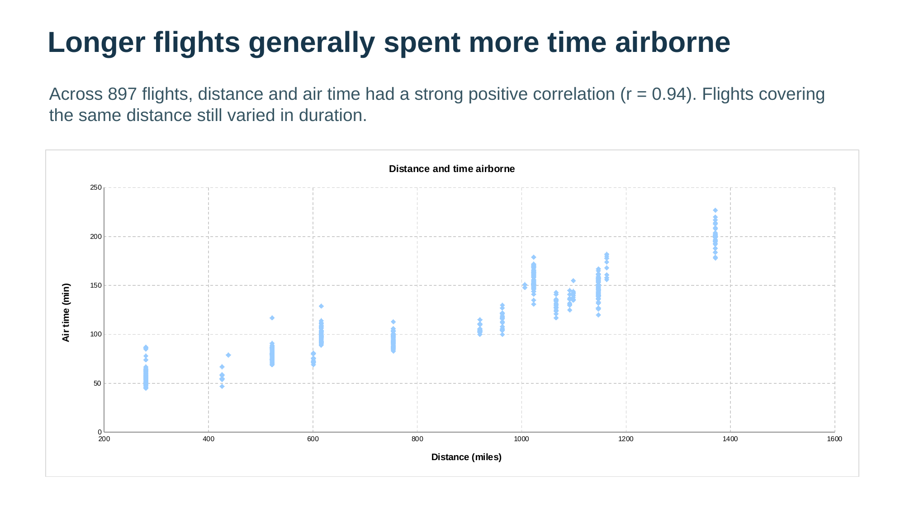

## Team Members

- [Derek Camacho](https://derek-c85.github.io/)
- [Easton Contorno](https://ejc017.github.io/)
- Josiah Cox – [e-portfolio](#) <!-- TODO: replace # with Josiah's e-portfolio URL -->
- Reese Martin – [e-portfolio](#) <!-- TODO: replace # with Reese's e-portfolio URL -->
- [Isaac Shilling](https://isaacshilling06.github.io/posts/Data%20Visualization/)

## About the Data Set

Our data comes from the U.S. Department of Transportation's Bureau of Transportation Statistics (BTS), Reporting Carrier On-Time Performance database. We filtered it to every scheduled departure from Northwest Arkansas National Airport (XNA) in January 2025, which gave us 933 flights. Each row is one flight and includes the date, the operating airline, the departure and arrival delays in minutes, whether the flight was canceled, the distance flown in miles, and the time spent in the air in minutes. Some fields are blank for canceled or diverted flights, so the number of flights used varies a little from question to question.

------------------------------------------------------------------------

## Question 1: How did departure delays change from day to day during January?

**Why it interests us:** XNA is our local airport, and many of us fly out of it during winter break. We wanted to know whether delays were spread evenly through the month or bunched up on certain days, perhaps because of winter weather.

**How we used Excel:** On the Plots sheet we grouped the 898 flights that had a recorded departure delay by date and used AVERAGEIFS to find the mean departure delay for each of the 31 days. Negative values mean the flights left early on average.

**How we developed the visual:** We used a line chart because the data is a time series and a line shows the rise and fall from one day to the next. The title states the main finding, a peak on January 10, and the sentence under it gives the exact number: an average of 185 minutes late across 14 flights. We kept a zero line on the y-axis so readers can see which days averaged early departures.

{fig-alt="Assertion-evidence slide: line chart of daily mean departure delay at XNA in January 2025, peaking at about 185 minutes on January 10."}

------------------------------------------------------------------------

## Question 2: Which airlines canceled the highest share of their flights?

**Why it interests us:** When you book a flight, the airline you pick can matter. We wanted to know whether some carriers at XNA were more likely than others to cancel.

**How we used Excel:** For each operating carrier we used COUNTIFS to count scheduled departures and canceled flights, then divided cancellations by scheduled departures to get a cancellation rate. The flight counts were: OH 20, AA 99, YX 92, MQ 473, OO 162, F9 4, G4 52, UA 31.

**How we developed the visual:** We chose a bar chart sorted from highest to lowest rate so the ranking is easy to read. We plotted rates rather than raw counts because MQ flies far more flights than any other carrier, so counts alone would be misleading. The supporting text makes that point directly: MQ canceled the most flights (20), but OH had the highest rate (10%, 2 of 20). We also noted in our presenter notes that one month of data cannot show that the airline caused the difference.

{fig-alt="Assertion-evidence slide: bar chart of cancellation rate by operating carrier, led by OH at 10 percent."}

------------------------------------------------------------------------

## Question 3: How are arrival delays distributed?

**Why it interests us:** Airlines often say most flights are on time, and we wanted to check that and see how bad the worst delays really were.

**How we used Excel:** We used the 897 flights with a recorded arrival delay and sorted them into 60-minute bins with the FREQUENCY function. We also used COUNTIF to find how many flights arrived early (575, or 64%) and MAX to find the longest delay (1,810 minutes).

**How we developed the visual:** A histogram was the best way to show the shape of the distribution. We kept the empty bins and the single 1,810-minute flight so the long right tail is visible rather than hidden. Each x-axis label is the midpoint of its bin (for example, −30 stands for −60 to under 0 minutes). The title states the takeaway: most flights arrived early, but a few were hours late.

{fig-alt="Assertion-evidence slide: histogram of arrival delays in 60-minute bins, with most flights early and a long right tail to 1,810 minutes."}

------------------------------------------------------------------------

## Question 4: Is there a relationship between flight distance and time in the air?

**Why it interests us:** We expected longer flights to take more time, but we wanted to measure how strong the relationship is and see how much flights on the same route vary.

**How we used Excel:** We paired distance (miles) with air time (minutes) for the 897 flights that had both values and used the CORREL function to calculate the Pearson correlation coefficient, which was r = 0.94.

**How we developed the visual:** A scatter plot is the standard way to show the relationship between two numeric variables, with one marker per flight. Because many flights fly the same route, the points form vertical columns at each distance. Those columns show that flights covering the same distance still differed in how long they spent in the air. We labeled both axes with units and put the correlation value in the supporting sentence.

{fig-alt="Assertion-evidence slide: scatter plot of distance versus air time for 897 flights, with correlation r = 0.94."}
